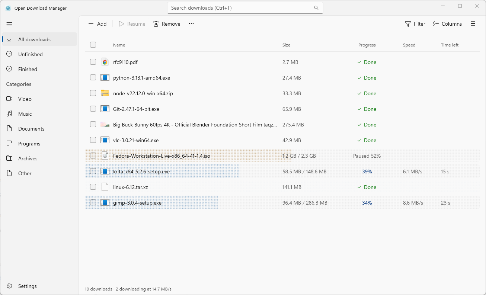
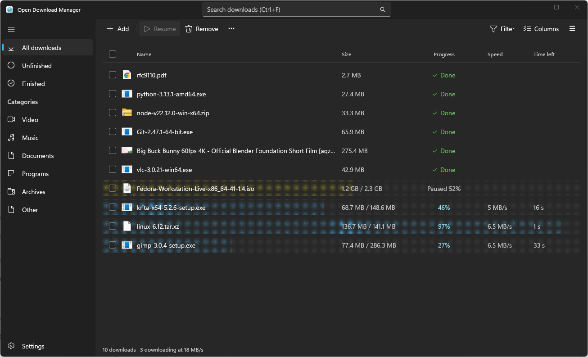
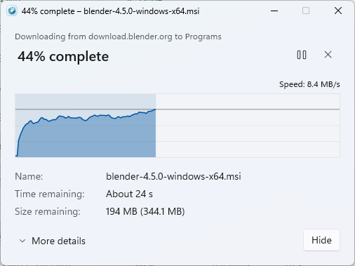
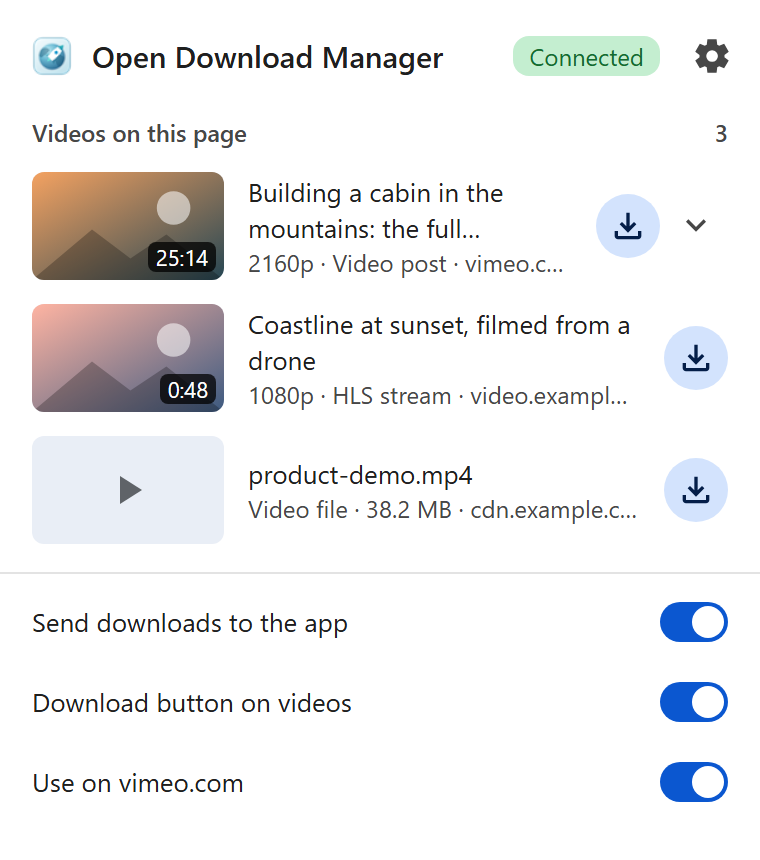
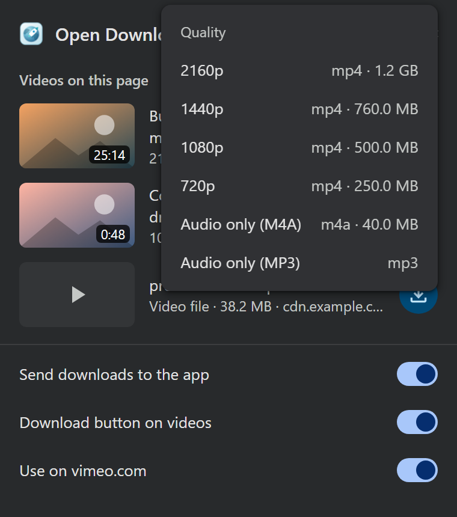
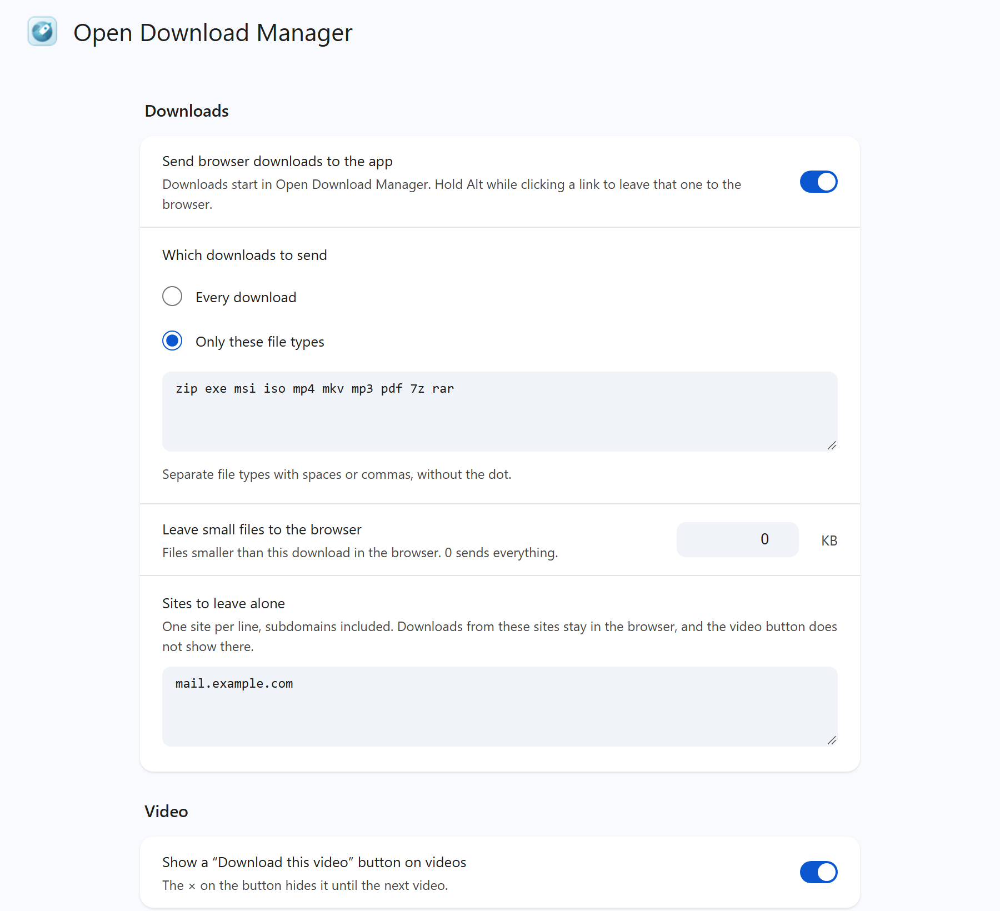

<p align="center">
  
</p>

<h1 align="center">Open Download Manager</h1>

<p align="center">
  A free, open source download manager for Windows, with a Chrome and Edge extension that hands it
  your downloads and videos.
</p>

<p align="center">
  <a href="https://github.com/Shadiul/open-download-manager/releases/latest"><b>Download for Windows</b></a>
  ·
  <a href="#install">Install</a>
  ·
  <a href="#build-from-source">Build</a>
  ·
  <a href="LICENSE">GPL-3.0</a>
</p>

<p align="center">
  
</p>

Fast segmented downloads, pause and resume that survive a restart, a queue with a schedule, and
video downloads from YouTube and many other sites through yt-dlp. It is for files and videos you
have the right to download: it does not get around DRM, paywalls, or logins you do not have.

## Features

**Fast and reliable downloads**

- Splits each file over up to 32 connections. When one connection finishes, it takes over half of
  the slowest remaining part, so no connection sits idle near the end.
- Pause, quit, or restart Windows: downloads continue where they stopped. If the file changed on
  the server, the download starts over instead of mixing two versions.
- Retries dropped connections, slows down for servers that say they are busy, and stays on one
  mirror for files served from many.
- A queue with a limit on parallel downloads, a daily time window, and sleep or shut down when
  everything is done. Speed limits overall and per download, in KB/s or MB/s.

**Video**

- Video pages from YouTube, Vimeo, X, Reddit, TikTok and the other sites
  [yt-dlp](https://github.com/yt-dlp/yt-dlp) supports, with a quality menu: 2160p down to 360p,
  M4A, or MP3. Video and audio are merged into one MP4.
- Streams the browser plays (HLS, DASH, MP4) show up in the extension, each with its own thumbnail.

**Made for Windows 11**

- Light and dark themes, Mica, three row densities, columns you choose, filters and search.
- A progress window per download, after the Windows file-copy dialog: a live speed graph and each
  connection's part of the file.
- Sorts files into Video, Music, Documents, Programs, Archives and Other folders.
- Marks finished files as downloaded from the internet (Mark of the Web), so Windows and your
  antivirus check them like browser downloads.
- Notifications, keeps the PC awake while downloading, starts with Windows, and offers to download
  links you copy.

<p align="center">
  
</p>
<p align="center">
  
</p>

## Browser extension

The extension (Manifest V3, Chrome and Edge) catches browser downloads and sends them to the app
with the page's cookies and referrer, so downloads behind a login keep working. If the app is not
running, it starts; if it is not installed, the browser keeps the download. Hold **Alt** while
clicking a link to leave that one to the browser.

It finds the videos on a page, shows how many on its icon, and puts a **Download** button on
videos. Right-click a link or a page for **Download with Open Download Manager** or
**Download all links**.

<p align="center">
  
  &nbsp;
  
</p>
<p align="center">
  
</p>

There are two builds of the extension, from the same code. The Chrome Web Store does not allow
YouTube downloads, so:

| Build | YouTube | Use it in |
|---|---|---|
| Edge | Download button and quality menu on YouTube | Microsoft Edge |
| Chrome | Off on YouTube: copy the video's link and the app offers the quality menu | Google Chrome |

## Install

You need Windows 10 (version 2004) or later, 64-bit.

1. From the [latest release](https://github.com/Shadiul/open-download-manager/releases/latest),
   download **OpenDownloadManager-…-setup-x64.exe** and run it. It installs for your user only and
   needs no administrator rights. There is also a portable zip.
2. Download the extension zip for your browser (**…-extension-edge.zip** or
   **…-extension-chrome.zip**) and unzip it.
3. Open `edge://extensions` or `chrome://extensions`, turn on **Developer mode**, choose
   **Load unpacked**, and pick the unzipped folder.
4. Start the app once. The extension's popup then says **Connected**.

The installer is not code-signed yet, so Windows SmartScreen may warn about it: choose
**More info**, then **Run anyway**. Each release lists SHA-256 checksums in `SHA256SUMS.txt`.

Store listings for the extension are planned; until then it is installed as above.

## Build from source

You need the Rust toolchain (1.88 or later, MSVC), the Visual Studio C++ build tools, the .NET 9
SDK, and Node.js 22.

```powershell
powershell -ExecutionPolicy Bypass -File scripts\fetch-tools.ps1   # yt-dlp and ffmpeg (LGPL), hash-checked
dotnet build windows\OpenDownloadManager -c Release
windows\OpenDownloadManager\bin\Release\net9.0-windows10.0.26100.0\win-x64\OpenDownloadManager.exe
```

The app build runs `cargo build --release` for the core first (skip it with
`-p:SkipRustBuild=true`) and copies `odm.dll`, `odm-host.exe` and `tools\` next to the app. On
every start the app registers the browser connection for Chrome and Edge under `HKCU`.

For the extension, load the `extension` folder unpacked (that is the Edge build), or run
`npm run build` for `dist\edge` and `dist\chrome`. Its ID, `ohammiojomdnbnfhigkofgahnghdmolg`, is
fixed by the `key` in `manifest.json` and is the ID the app allows.

`scripts\package.ps1` builds everything a release ships (it needs
[Inno Setup 6](https://jrsoftware.org/isinfo.php) for the installer, or pass `-SkipInstaller`).

Setting `ODM_PROFILE=name` runs a second copy of the app with its own data and downloads folder,
next to your everyday one: handy for trying changes.

### Tests

```powershell
cd core; cargo test --workspace     # engine against a misbehaving local server, queue, browser pipe, host
npm test                            # extension unit tests
npm install; npm run test:e2e       # loads the extension in Chromium with a test host
```

## How it is built

```
core/                         Rust core, shared with a planned macOS app
  crates/odm-core             engine, queue, SQLite state, yt-dlp, browser pipe, protocol
  crates/odm-host             native messaging host: relays the extension to the app
  crates/odm-ffi              odm.dll, the C interface the Windows app calls
windows/OpenDownloadManager/  WinUI 3 app (C#, .NET 9)
extension/                    browser extension (Manifest V3)
installer/                    Inno Setup script for the Windows installer
native-host/PROTOCOL.md       messages between the extension and the app
scripts/                      tool fetching, packaging, versioning, icon rendering
tests/                        extension unit and end-to-end tests
```

## Contributing

Issues and pull requests are welcome.

- Work happens on the `dev` branch. Open pull requests against `dev`.
- `dev` is merged into `main` with a pull request when a set of changes is ready and stable.
  Every pull request into `main` builds the installer and zips as downloadable artifacts, to try
  before merging.
- A merge into `main` with a new version publishes a release automatically. Set the version in
  all four places at once with `node scripts/version.mjs 0.2.0`.
- Run `cargo test` in `core` and `npm test` before sending a change. Changes to the messages in
  `native-host/PROTOCOL.md` need matching changes in `odm-core/src/protocol.rs` and the extension.
- Tests use a local test server and generated files; please don't add links to copyrighted videos.

## License

[GNU General Public License v3.0](LICENSE).

Bundled tools: [yt-dlp](https://github.com/yt-dlp/yt-dlp) (Unlicense), an LGPL build of
[FFmpeg](https://github.com/BtbN/FFmpeg-Builds) that runs as a separate program, and
[Deno](https://github.com/denoland/deno) (MIT), the JavaScript runtime yt-dlp uses for YouTube. Deno
is not in the installer: the app downloads it, and checks its checksum, the first time a YouTube
video needs it.
