<p align="center">
  
</p>

<h1 align="center">Open Download Manager</h1>

<p align="center">
  <b>A free, open-source download manager for Windows.</b><br>
  Fast segmented downloads, a browser extension that hands it your files and videos,<br>
  and a look that fits right in on Windows 11.
</p>

<p align="center">
  <a href="https://github.com/Shadiul/open-download-manager/releases/latest"></a>
  <a href="https://github.com/Shadiul/open-download-manager/releases"></a>
  <a href="LICENSE"></a>
  
</p>

<p align="center">
  <a href="https://github.com/Shadiul/open-download-manager/releases/latest"></a>
</p>

<p align="center">
  <a href="#features">Features</a> ·
  <a href="#the-download-button-on-videos">Video button</a> ·
  <a href="#install">Install</a> ·
  <a href="#privacy-and-what-it-is-for">Privacy</a> ·
  <a href="#build-from-source">Build</a> ·
  <a href="#contributing">Contributing</a>
</p>

<p align="center">
  <a href="docs/media/demo.mp4">
    
  </a>
  <br>
  <sub>From the browser to a finished file in 40 seconds. <a href="docs/media/demo.mp4">Watch it in full quality (MP4)</a>.</sub>
</p>

Open Download Manager splits each file over many connections, resumes after a pause, a quit or a
restart, keeps a queue with a schedule, and downloads videos from YouTube and many other sites
through yt-dlp. It is for files and videos you have the right to download: it does not get around
DRM, paywalls, or logins you do not have.

<p align="center">
  <picture>
    <source media="(prefers-color-scheme: dark)" srcset="docs/screenshots/hero-dark.png">
    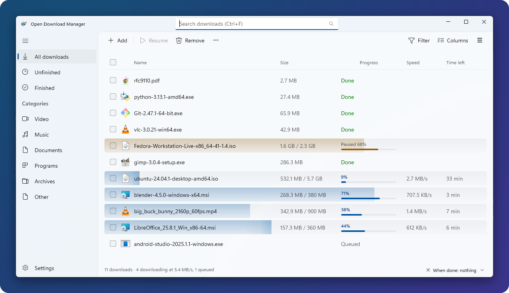
  </picture>
</p>

## Features

<table>
  <tr>
    <td width="50%" valign="top">
      <b>Fast and reliable</b><br>
      Up to 32 connections per file. Downloads carry on after a pause, a quit or a restart of Windows.
    </td>
    <td width="50%" valign="top">
      <b>Videos from the sites you use</b><br>
      YouTube, Vimeo, X, Reddit, TikTok and the other sites yt-dlp supports, from 2160p down to MP3.
    </td>
  </tr>
  <tr>
    <td valign="top">
      <b>Catches browser downloads</b><br>
      An extension for Edge, Chrome, Brave, Vivaldi and Opera sends downloads to the app, logins included.
    </td>
    <td valign="top">
      <b>Made for Windows 11</b><br>
      Mica, light and dark themes, your accent colour, a tray flyout and a progress window per download.
    </td>
  </tr>
</table>

### The download button on videos

> **Point at a video on a web page, and a *Download this video* button appears in its corner.**
> One click hands that video to the app.

<p align="center">
  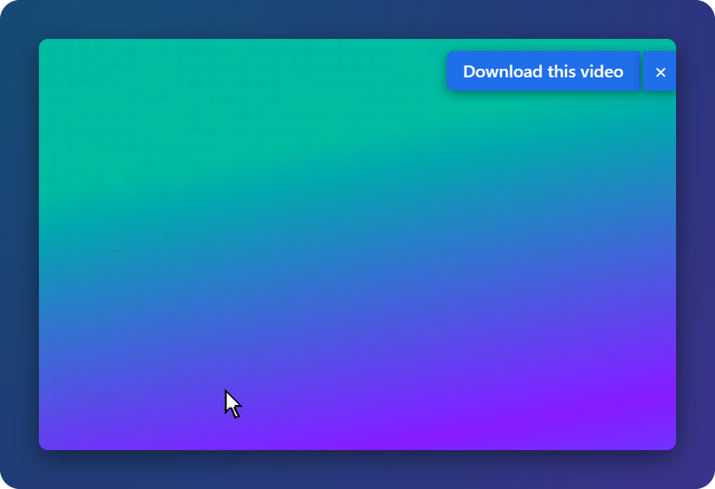
</p>

- The button always takes the video it sits on, even on a page with several.
- On YouTube and on post sites (X, Reddit, Instagram, TikTok, Vimeo) it opens a quality menu first.
  On other sites it sends the stream the browser played for that video.
- The **×** next to it hides it for that video. Turn it off for good in the extension's popup or
  settings, or list sites to leave alone.
- The Chrome build leaves YouTube out, because the Chrome Web Store does not allow YouTube
  downloads (see [Browser extension](#browser-extension)).

### A new download starts at once

A download from the browser starts straight away while the new-download window asks for the name
and folder. The change applies when it finishes.

<p align="center">
  <picture>
    <source media="(prefers-color-scheme: dark)" srcset="docs/screenshots/new-download-dark.png">
    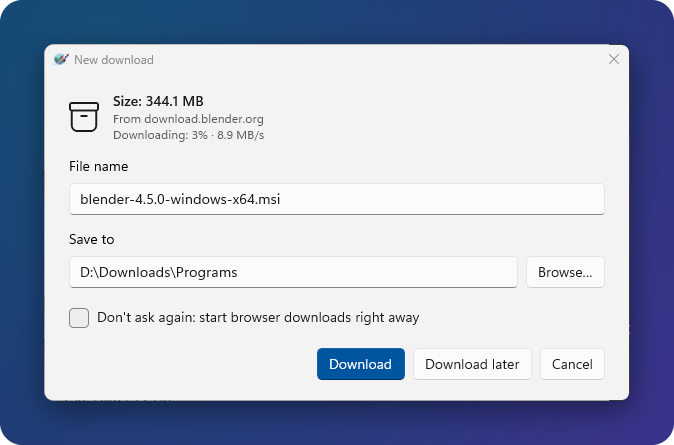
  </picture>
</p>

### Fast, and it keeps going

- Splits each file over up to 32 connections. When one connection finishes, it takes over half of
  the slowest remaining part, so no connection sits idle near the end.
- Pause, quit, or restart Windows: downloads continue where they stopped. If the file changed on
  the server, the download starts over instead of mixing two versions.
- Retries dropped connections, slows down for servers that say they are busy, and stays on one
  mirror for files served from many.
- A queue with a limit on parallel downloads, a daily time window, and sleep or shut down when
  everything is done. Speed limits overall and per download, in KB/s or MB/s.
- A progress window per download, after the Windows file-copy dialog: a live speed graph and each
  connection's part of the file.

<p align="center">
  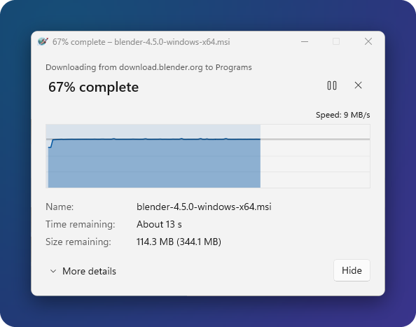
  &nbsp;
  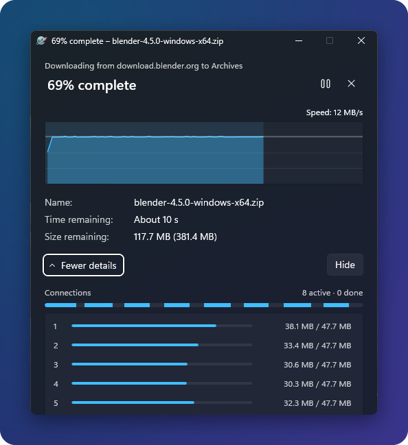
</p>

### Everything at a glance in the tray

Click the tray icon for the total speed, every running download with its own pause button, a box to
paste a link, **Pause all**, and what to do when everything is done.

<p align="center">
  <picture>
    <source media="(prefers-color-scheme: dark)" srcset="docs/screenshots/tray-dark.png">
    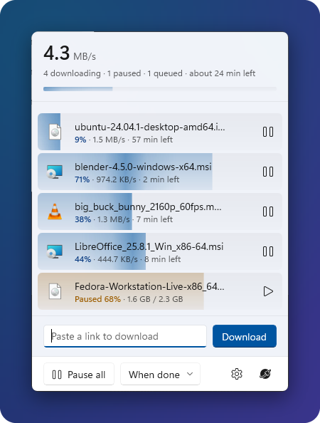
  </picture>
</p>

### After a download

<p align="center">
  <picture>
    <source media="(prefers-color-scheme: dark)" srcset="docs/screenshots/complete-dark.png">
    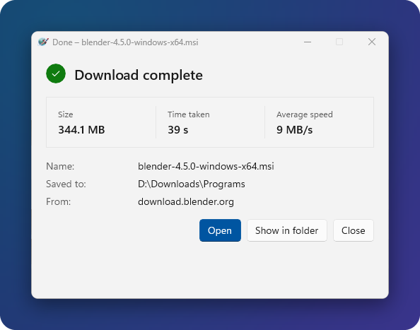
  </picture>
</p>

- Open the file, show it in its folder, or extract ZIP, 7z, RAR and TAR archives into a folder next
  to them (and send the archive to the Recycle Bin). Programs and scripts are never started by
  themselves.
- When everything is done: sleep, hibernate, shut down, restart, sign out, lock, or close the app,
  after a countdown you can cancel. Set it in Settings, or for just this time from the status bar
  or the tray.
- Download again, rename or move finished files, and a separate "finishing" state while a file is
  saved or a video's picture and sound are merged.
- Sorts files into Video, Music, Documents, Programs, Archives and Other folders.
- Marks finished files as downloaded from the internet (Mark of the Web), so Windows and your
  antivirus check them like browser downloads.

### Make it yours

Light and dark themes, Windows' accent or any colour of your own, and Mica, Mica Alt, Acrylic or a
solid window. Settings show a live preview of every change.

<p align="center">
  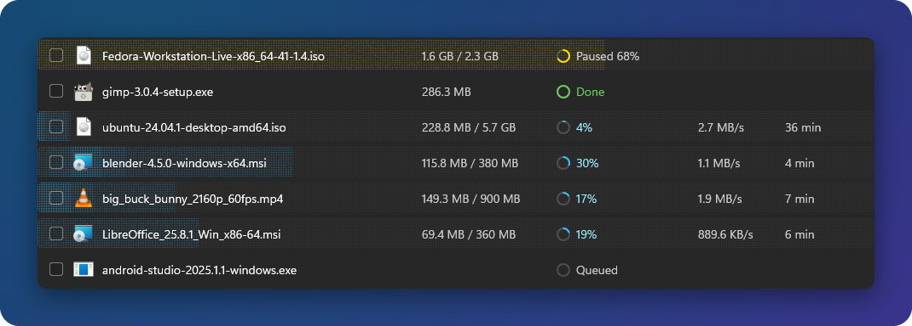
  &nbsp;
  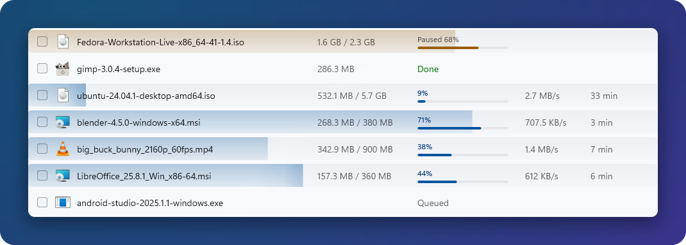
</p>

- **Progress across the row:** a bar that fills the whole row, a thin underline, or off. Its look
  is a dot matrix, a solid or glass fill, or stripes.
- **Progress in the Progress column:** a ring or a bar beside the percentage, or text only, in the
  same four looks.
- A band of light that moves along downloading rows (calm, lively or off). Tint rows subtly or
  vividly, by status or by file type.
- Three row densities, columns you choose, filters, and search in the title bar (Ctrl+F).

<p align="center">
  <picture>
    <source media="(prefers-color-scheme: dark)" srcset="docs/screenshots/row-styles-dark.png">
    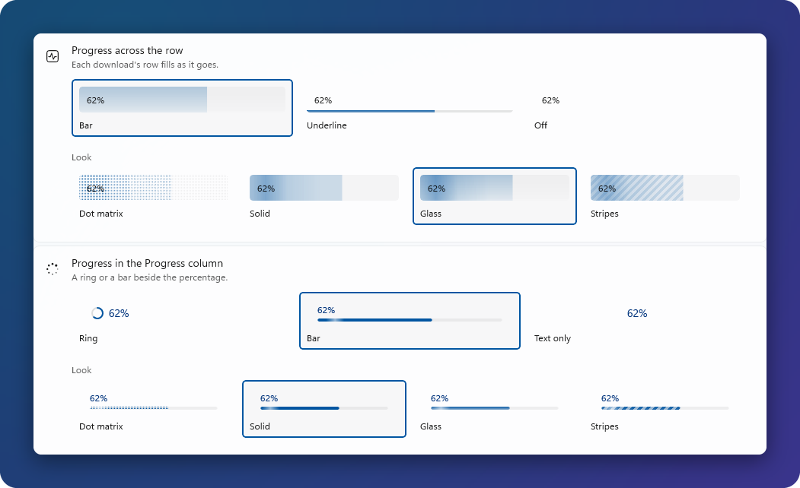
  </picture>
</p>

**Two app icons.** Pick Orbit or Smoke in Settings → Appearance. It changes the windows, the
taskbar, Alt+Tab and the Start menu and desktop shortcuts.

<p align="center">
  <picture>
    <source media="(prefers-color-scheme: dark)" srcset="docs/screenshots/app-icon-dark.png">
    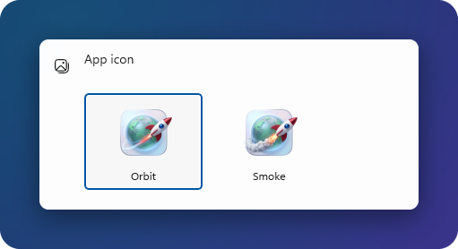
  </picture>
</p>

### Video

- Video pages from YouTube, Vimeo, X, Reddit, TikTok and the other sites
  [yt-dlp](https://github.com/yt-dlp/yt-dlp) supports, with a quality menu: 2160p down to 360p,
  M4A, or MP3. Video and audio are merged into one MP4.
- Streams the browser plays (HLS, DASH, MP4) show up in the extension's popup, each with its own
  thumbnail.

### Everyday comforts

Notifications, keeps the PC awake while downloading, starts with Windows, and offers to download
links you copy.

## Browser extension

The extension (Manifest V3) catches browser downloads and sends them to the app with the page's
cookies and referrer, so downloads behind a login keep working. If the app is not running, it
starts; if it is not installed, the browser keeps the download. Hold **Alt** while clicking a link
to leave that one to the browser.

It finds the videos on a page, shows how many on its icon, and puts the
[download button](#the-download-button-on-videos) on videos. Right-click a link or a page for
**Download with Open Download Manager** or **Download all links with Open Download Manager**.

There are two builds of the extension, from the same code. The Chrome Web Store does not allow
YouTube downloads, so:

| Build | YouTube | Use it in |
|---|---|---|
| Edge | Download button and quality menu on YouTube | Microsoft Edge |
| Chrome | Off on YouTube: copy the video's link and the app offers the quality menu | Google Chrome |

## Install

You need Windows 10 (version 2004) or later, 64-bit.

1. From the [latest release](https://github.com/Shadiul/open-download-manager/releases/latest),
   download **OpenDownloadManager-…-setup-x64.exe** and run it. It installs for your user only and
   needs no administrator rights. There is also a portable zip.
2. Start the app. A short welcome sets the look, the download folder and starting with Windows.
3. **Add the extension.** The welcome lists the browsers on your PC (Edge, Chrome, Brave, Vivaldi,
   Opera); choose **Add** next to each one you use. The app opens the browser's extensions page
   with the extension's folder beside it: turn on **Developer mode** and drag the folder onto the
   page. The app notices when the extension is in, and the extension updates with the app.
   You can add it later from **Settings → Browsers**.

<p align="center">
  <picture>
    <source media="(prefers-color-scheme: dark)" srcset="docs/screenshots/welcome-dark.png">
    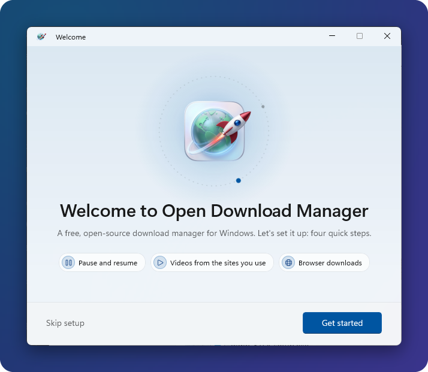
  </picture>
  &nbsp;
  <picture>
    <source media="(prefers-color-scheme: dark)" srcset="docs/screenshots/welcome-browsers-dark.png">
    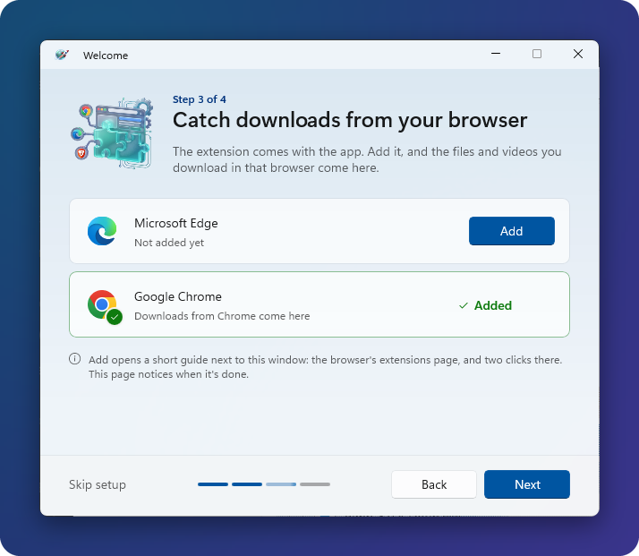
  </picture>
</p>

The extension also comes as a zip on each release (**…-extension-edge.zip**,
**…-extension-chrome.zip**) to load by hand with **Load unpacked**.

The installer is not code-signed yet, so Windows SmartScreen may warn about it: choose
**More info**, then **Run anyway**. Each release lists SHA-256 checksums in `SHA256SUMS.txt`.

Browsers only install extensions from outside their stores by hand, which is why adding it takes
those steps. Store listings are planned; with them, adding it becomes a single click.

## Privacy and what it is for

- Open Download Manager is for files and videos you have the right to download. It does not get
  around DRM, paywalls, or logins you do not have.
- The extension sends downloads only to the app on your own PC, through the browser's native
  messaging; there is no server of its own. Besides that it reads only what the page itself loads,
  such as a video's playlist to tell its qualities apart.
- With each download it passes along the page's cookies and referrer, so that downloads behind a
  login you have keep working.
- Finished files are marked as downloaded from the internet (Mark of the Web), so Windows and your
  antivirus check them like browser downloads. Programs and scripts are never started by
  themselves.
- Deno is not in the installer: the app downloads it, and checks its checksum, the first time a
  YouTube video needs it.

## Build from source

You need the Rust toolchain (1.88 or later, MSVC), the Visual Studio C++ build tools, the .NET 9
SDK, and Node.js 22.

```powershell
powershell -ExecutionPolicy Bypass -File scripts\fetch-tools.ps1   # yt-dlp and ffmpeg (LGPL), hash-checked
dotnet build windows\OpenDownloadManager -c Release
windows\OpenDownloadManager\bin\Release\net9.0-windows10.0.26100.0\win-x64\OpenDownloadManager.exe
```

The app build runs `cargo build --release` for the core first (skip it with
`-p:SkipRustBuild=true`) and copies `odm.dll`, `odm-host.exe` and `tools\` next to the app. On
every start the app registers the browser connection for Chrome and Edge under `HKCU`.

For the extension, load the `extension` folder unpacked (that is the Edge build), or run
`npm run build` for `dist\edge` and `dist\chrome`. Its ID, `ohammiojomdnbnfhigkofgahnghdmolg`, is
fixed by the `key` in `manifest.json` and is the ID the app allows.

`scripts\package.ps1` builds everything a release ships (it needs
[Inno Setup 6](https://jrsoftware.org/isinfo.php) for the installer, or pass `-SkipInstaller`).

Setting `ODM_PROFILE=name` runs a second copy of the app with its own data and downloads folder,
next to your everyday one: handy for trying changes.

### Tests

```powershell
cd core; cargo test --workspace     # engine against a misbehaving local server, queue, browser pipe, host
npm test                            # extension unit tests
npm install; npm run test:e2e       # loads the extension in Chromium with a test host
```

### How it is built

```
core/                         Rust core, shared with a planned macOS app
  crates/odm-core             engine, queue, SQLite state, yt-dlp, browser pipe, protocol
  crates/odm-host             native messaging host: relays the extension to the app
  crates/odm-ffi              odm.dll, the C interface the Windows app calls
windows/OpenDownloadManager/  WinUI 3 app (C#, .NET 9)
extension/                    browser extension (Manifest V3)
installer/                    Inno Setup script for the Windows installer
native-host/PROTOCOL.md       messages between the extension and the app
scripts/                      tool fetching, packaging, versioning, icon rendering
tests/                        extension unit and end-to-end tests
```

## Contributing

Issues and pull requests are welcome.

- Work happens on the `dev` branch. Open pull requests against `dev`.
- `dev` is merged into `main` with a pull request when a set of changes is ready and stable.
  Every pull request into `main` builds the installer and zips as downloadable artifacts, to try
  before merging.
- A merge into `main` with a new version publishes a release automatically. Set the version in
  all four places at once with `node scripts/version.mjs 0.2.0`.
- Run `cargo test` in `core` and `npm test` before sending a change. Changes to the messages in
  `native-host/PROTOCOL.md` need matching changes in `odm-core/src/protocol.rs` and the extension.
- Tests use a local test server and generated files; please don't add links to copyrighted videos.

## License

[GNU General Public License v3.0](LICENSE).

Bundled tools: [yt-dlp](https://github.com/yt-dlp/yt-dlp) (Unlicense), an LGPL build of
[FFmpeg](https://github.com/BtbN/FFmpeg-Builds) that runs as a separate program, and
[Deno](https://github.com/denoland/deno) (MIT), the JavaScript runtime yt-dlp uses for YouTube. Deno
is not in the installer: the app downloads it, and checks its checksum, the first time a YouTube
video needs it.
